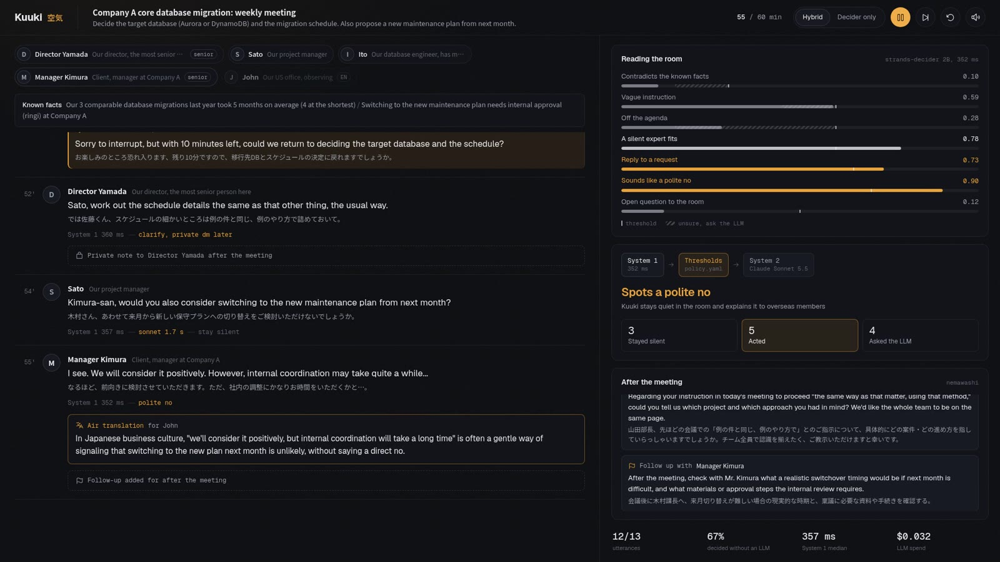

# Kuuki: an AI teammate that reads the room

*Kuuki (空気) means "air". Reading the air (空気を読む) is knowing what not to say, and when.*

Kuuki listens to a meeting and decides, after every utterance, **whether** to speak,
**what** to do and **how** to say it. Most of the time it says nothing.

- **invite_quiet**: someone asks the room a question while the right expert has not spoken yet
- **correct**: a statement contradicts the known facts
- **refocus**: the talk has left the agenda for two utterances in a row
- **clarify**: an instruction is only "that thing, the usual way" (例の件、例のやり方)
- **tatemae**: a polite "no" that sounds like "yes" gets an English *air translation* for overseas members

…delivered **directly**, **softly**, or as a **private message after the meeting** (*nemawashi*,
根回し) when correcting a senior person without being very sure.



Demo video (under 3 minutes): <!-- TODO: YouTube URL -->

## What Kuuki does, and what it doesn't

| Reads | Decides, after every utterance | Does |
|---|---|---|
| The live transcript (from the meeting tool's captions) | Speak or not, which move, and how | Stays silent (most of the time) |
| Who is in the room: names, roles, who outranks whom | | Says one short line in the room |
| Facts it was given, e.g. the project record | | Sends a private note after the meeting |
| | | Explains a polite no to overseas members |

Not in this project: speech recognition and looking up the facts. Kuuki can only correct what
contradicts the facts it was handed (`facts` in the scenario). The demo replays a scripted
Japanese meeting; every decision in it is made live.

## How it works

```
utterance ──> strands-decider 2B: 7 yes/no probes, one batch (~350 ms, local GPU)
                 │
                 └─> threshold table (YAML) ──┬─ stay silent ──────────────> no model call
                                              ├─ act ─────────────────────> Claude Sonnet 5.5 writes the words
                                              └─ silent, but unsure ──────> Claude Sonnet 5.5 decides (System 2)
```

[strands-decider](https://github.com/strands-labs/strands-decider) is System 1: fast, local,
and it returns calibrated numbers, so the code can tell when it is unsure. Claude on
Amazon Bedrock is System 2, called only when Kuuki acts or System 1 is in a known gray zone.
The gate is a [Strands Agents](https://github.com/strands-agents/sdk-python) `InterventionHandler`.

## Results on 70 labeled meeting scenes

| | Exact match (70) | Independent check (20) | Median latency per decision | LLM cost / 1000 decisions |
|---|---|---|---|---|
| strands-decider only | 55 | 16 | 331 ms | $0 |
| Claude Haiku 5.5 only | 60 | 16 | 1,264 ms | $0.14 |
| Claude Sonnet 5.5 only | 69 | 20 | 1,366 ms | $2.68 |
| **Kuuki (decider + Sonnet)** | **66** | **18** | **337 ms** | **$0.61** |

94% exact match at about a quarter of Sonnet's latency and cost; 77% of decisions are
made without asking the LLM (it still writes the words when Kuuki acts). The independent check is 20 scenes written after the thresholds were frozen. Method, per-move results and caveats: [docs/evaluation.md](docs/evaluation.md);
raw outputs and re-scoring without a GPU: [results/](results/README.md).

## The reusable pattern

[`patterns/interjection_policy/`](patterns/interjection_policy/README.md) (pattern tag: `#policy`)
is the part meant for reuse: typed probes with criteria, a threshold table with
`requires` / `unless` / `consecutive` rules and escalation gray zones, and a Strands
`InterventionHandler` that returns `Deny` or `Transform` before any model call.

```python
from strands import Agent
from patterns.interjection_policy import InterjectionHandler

agent = Agent(model=..., system_prompt=..., interventions=[InterjectionHandler()])
result = agent(prompt, invocation_state={"room": room})
```

## Quickstart

Requirements: an NVIDIA GPU with 8 GB or more (tested on an RTX 4060 Laptop, WSL2),
[uv](https://docs.astral.sh/uv/), and AWS credentials with Amazon Bedrock access to
Claude Sonnet 5.5 (`global.anthropic.claude-sonnet-5-5`) and Amazon Polly (Kuuki's voice in the
web UI). Claude Haiku 5.5 (`jp.anthropic.claude-haiku-5-5`) is only needed for
`--writer haiku` and the Haiku comparison.

```bash
uv sync

# 1. System 1: strands-decider (downloads the checkpoint and its Qwen3.5-2B base, ~4.5 GB)
uv run strands-decider serve StrandsAgents/strands-decider-2B-qwen3.5-v1-2610 --port 8000

# 2. Replay the demo meeting (another terminal)
export AWS_PROFILE=<your profile>
uv run python -m agent.pipeline scenarios/demo_meeting_ja.yaml
#   --judge none                  strands-decider decides alone
#   --judge none --writer none    no Bedrock calls at all

# The web UI (dark, built for the demo video): http://127.0.0.1:8765
uv run uvicorn app.server:app --port 8765

# The same meeting through a Strands agent gated by the pattern
uv run python -m patterns.interjection_policy.example_strands scenarios/demo_meeting_ja.yaml

# Tests (no model needed)
uv run pytest -q tests
```

`pyproject.toml` pins the CUDA 12.6 build of PyTorch; change the index if your driver differs.

Laptop GPUs drop their clocks after about a second idle (on the demo meeting: ~345 ms back to back,
~600 ms after a 2.6 s pause). While the web UI waits between utterances it re-sends the current
state to strands-decider every 0.5 s to stay warm; `KUUKI_KEEP_WARM=0` turns this off.

### Evaluation

```bash
uv run python eval/run_eval.py --split tune      # strands-decider + thresholds; caches probabilities
uv run python eval/run_eval.py --split tune --from-cache   # re-score after editing thresholds.yaml
uv run python eval/compare_llm.py --split all --model sonnet   # decider vs LLM vs hybrid
```

## Repository layout

| Path | Contents |
|---|---|
| `patterns/interjection_policy/` | The reusable pattern (probes, thresholds, policy, Strands handler, prompts, example) |
| `agent/` | Kuuki itself: meeting state, decision engine, Bedrock writer, LLM judge baseline, CLI replay |
| `app/` | The web UI: FastAPI + WebSocket server and a static dark-theme page |
| `scenarios/` | The demo meeting and the 70 labeled evaluation scenes (Japanese) |
| `eval/` | Scoring, the LLM comparison and tuning aids |
| `tests/` | Tests for the policy and the handler |
| `results/` | Raw outputs behind the numbers, re-scorable without a GPU or AWS |
| `docs/` | The evaluation report |

All people, companies and meetings in the scenarios are fictional.

## License

[Apache-2.0](LICENSE). strands-decider and the Qwen3.5-2B base model are also Apache-2.0.
